# Add these graphics to your GitHub profile README

These SVGs use a dark-navy and electric-blue palette. Upload all five SVG files to the root of your `Wizzy-balzz/Wizzy-balzz` repository, then reference them from `README.md`:

```html
<div align="center">
  
  
  
  
  
</div>
```

If your README already contains these image references, you only need to replace the five SVG files with these updated versions and commit the changes.

Before publishing, preview every SVG and make sure its text and statistics are accurate. SVG graphics can be static or animated depending on the content and where they are rendered.
